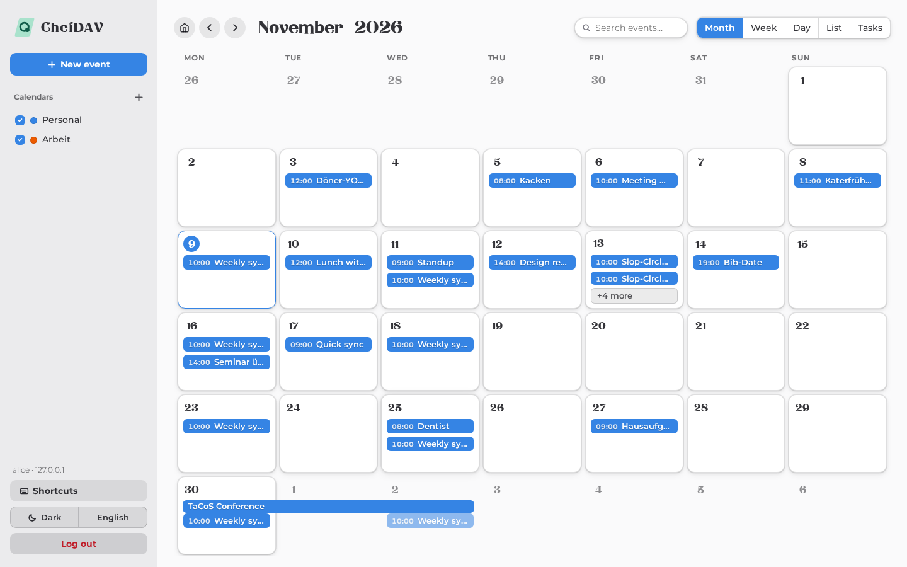
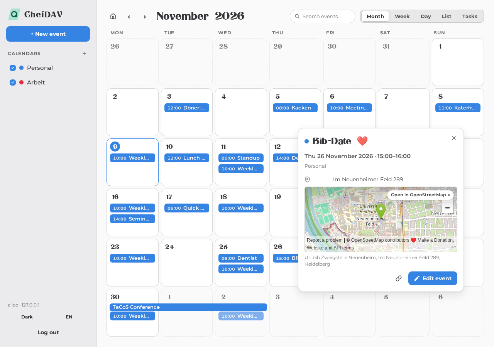

# ChefDAV

A **calendar web app that runs entirely in your browser** — written in **Rust,
compiled to WebAssembly**, talking directly to a **CalDAV server (Radicale)**.
There is no application backend: the only server-side pieces you operate are
Radicale itself plus a reverse proxy in front of it (TLS, and CORS when the app
is served from another origin).

All static assets — **fonts included** — are bundled and served same-origin:
nothing is loaded from Google, Facebook or any other third-party CDN. The app
only talks to your calendar server (plus OpenStreetMap for the optional
location map preview).

Inspired by [AgenDAV](https://github.com/agendav/agendav) (PHP) — same idea,
GNOME Adwaita looks, Rust reliability.

> ⚠️ **Warning: this project is written entirely by AI.** The code, design and
> docs were generated by an AI assistant. Treat it like code from any other
> unreviewed source: read it before you trust it, test it against your own
> server, and do not run it with credentials you care about until you have
> reviewed what it does with them. No warranty — see [LICENSE](LICENSE).



## What you get

- **Five views** — Month grid, Week timeline, Day timeline, a 30-day List view
  and a Tasks list — with a shared toolbar (prev / today / next, view switcher,
  search). The current view and date live in the URL (`/month/2026-11`,
  `/week/2026-11-16`, `/day/…`, `/list/…`, `/tasks`), so any screen can be
  reloaded or shared. In the timelines, overlapping events are packed in
  clusters ("Tetris" style): each block gets exactly as many columns as its
  busiest moment needs — capped at two in week view and four in the
  full-width day view, with a "+N more" bar per overflowing block that
  counts every hidden event — and event titles stay pinned at the top while
  you scroll.
- **Deep links** — every event and task has its own URL
  (`/event/<calendar>/<uid>`, `/task/<calendar>/<uid>`, with `?occ=…` for a
  single occurrence of a recurring event). Opening a resource updates the
  address bar (and there is a copy-link button in the details card); opening
  such a link — also on a fresh load — opens that resource directly.
- **Full event CRUD** over CalDAV (create / edit / delete, optimistic
  concurrency via `If-Match`), with a read-only details card before the editor.
- **Multi-day events** — the editor has an end-date picker for all-day *and*
  overnight timed events; month and week views render them as spanning bars
  with striped continuation fades at week boundaries and day edges. Events
  that cross a month boundary are shown in **both** months.
- **Jump anywhere** — click the month or the year in the toolbar title to get a
  month picker or a year grid, and the details card has a **New event** button
  that starts a copy in the same date and time slot.
- **Timezone-aware** — events render in your browser's timezone, whether they
  carry a `TZID` from another client or were saved as UTC (DST-correct).
- **Recurrence** — RRULE/RDATE/EXDATE expanded client-side in the event's own
  timezone (DST-correct), an RRULE editor, and RECURRENCE-ID exceptions
  (*this event* / *this and following* / *all events*).
- **Multiple calendars** — create, rename, delete, show/hide, recolor (stored on
  the server via PROPPATCH), read-only detection, and a sharing panel with the
  calendar URL, your privileges and Radicale `[rights]` guidance.
- **Tasks (VTODO)** — create, edit, complete, delete.
- **Search, multi-select + bulk delete, drag & drop** between days.
- **Offline-friendly** — IndexedDB cache for instant paint, `sync-token`
  incremental sync, and an offline outbox that retries queued writes.
- **Stay logged in** — the saved session is restored on reload (with an opt-out
  checkbox; logging out forgets the password).
- **Location maps** — coordinates or addresses in an event's location show an
  OpenStreetMap preview with a pin; clicking it opens OSM in a new tab.
- **Look & feel** — the **GTK4/libadwaita (GNOME Adwaita) design**: real
  Adwaita colors/radii from GNOME's stylesheet, accent blue `#3584e4`, flat
  raised buttons with a blue suggested-action primary, segmented view
  switcher, accent "today" circle, GTK-style checkbuttons and a pill search
  entry. Light is the default, dark is Adwaita dark. **Klarissa** sets the
  wordmark and headings, **Montserrat** the body text (both self-hosted).
  Full **English/German** UI (labels, dates,
  recurrence descriptions), keyboard shortcuts (`n t m w d a k / arrows
  Esc`), responsive down to phone widths.

| Week | List | Event details with map |
| --- | --- | --- |
|  |  |  |

## How it works

ChefDAV is a single-page app. The browser loads the WASM bundle once and then
talks CalDAV directly to your server — `PROPFIND`, `REPORT`, `PUT`,
`MKCALENDAR`, … — with HTTP Basic auth. There is no application backend in
between.

- **Logins are forwarded to Radicale**: the app sends the username and password
  as Basic auth, and Radicale decides whether they are valid.
- **Who may read/write what** is decided by Radicale's `[rights]` file; the app
  reflects read-only calendars with a lock.
- All protocol, ICS and recurrence logic lives in a **pure-Rust crate**
  (`crates/caldav`) with native unit tests — the browser code is only glue + UI.

## Deploy with Docker Compose

The published image `ghcr.io/chefexperte/chefdav` contains **only the calendar
frontend**: the static Rust/WASM app on a small Caddy file server. There is no
CalDAV server inside it — the browser talks straight to *your* Radicale, so the
proxy in front of Radicale must answer CORS preflights.

The stack below is complete: **Traefik** routes by host and path and adds the
CORS headers, **Radicale** serves CalDAV at the site root, and **ChefDAV** is
published under `/ui` on the same host.

```yaml
name: chefdav

services:
  traefik:
    image: traefik:v3
    command:
      - --providers.docker=true
      - --providers.docker.exposedbydefault=false
      - --entrypoints.web.address=:80
    ports:
      - "8080:80"
    volumes:
      - /var/run/docker.sock:/var/run/docker.sock:ro

  radicale:
    image: tomsquest/docker-radicale:3.9.0.0
    volumes:
      - ./radicale/config:/config/config:ro
      - ./radicale/users:/config/users:ro
      - radicale-data:/data
    labels:
      - traefik.enable=true
      - traefik.http.routers.radicale.rule=Host(`calendar.example.com`)
      - traefik.http.routers.radicale.entrypoints=web
      - traefik.http.services.radicale.loadbalancer.server.port=5232
      # CORS for the app's origin (see the note below).
      - traefik.http.routers.radicale.middlewares=caldav-cors
      - traefik.http.middlewares.caldav-cors.headers.accesscontrolalloworiginlist=https://calendar.example.com
      - traefik.http.middlewares.caldav-cors.headers.accesscontrolallowmethods=GET,POST,PUT,DELETE,PROPFIND,PROPPATCH,REPORT,MKCOL,MKCALENDAR,OPTIONS
      - traefik.http.middlewares.caldav-cors.headers.accesscontrolallowheaders=Authorization,Content-Type,Depth,If-Match,If-None-Match,Overwrite
      - traefik.http.middlewares.caldav-cors.headers.accesscontrolexposeheaders=ETag,DAV,Content-Length
      - traefik.http.middlewares.caldav-cors.headers.accesscontrolmaxage=600

  chefdav:
    image: ghcr.io/chefexperte/chefdav:latest
    environment:
      BACKEND_URL: https://calendar.example.com
      BASE_PATH: /ui
    read_only: true
    tmpfs:
      - /srv-runtime
      - /tmp
    labels:
      - traefik.enable=true
      - traefik.http.routers.ui.rule=Host(`calendar.example.com`) && PathPrefix(`/ui`)
      - traefik.http.routers.ui.entrypoints=web
      - traefik.http.routers.ui.middlewares=ui-strip
      - traefik.http.services.ui.loadbalancer.server.port=80
      # The container answers both the prefixed and the stripped path, so
      # removing this middleware works too.
      - traefik.http.middlewares.ui-strip.stripprefix.prefixes=/ui

volumes:
  radicale-data:
```

`docker compose up -d`, then open `https://calendar.example.com/ui/` once that
name points at the machine (for a local test, map it to `127.0.0.1` and use port
8080). Log in with your CalDAV credentials.

- **Radicale config** — `./radicale/config` and `./radicale/users` are its
  configuration and htpasswd file; [`docker/radicale/`](docker/radicale/) has
  working examples (dev login `alice` / `secret`).
- **CORS** — if the app and the CalDAV server share an origin (same host and
  port, as above), the browser does not need CORS at all. The middleware is
  required when the app is served from another origin, and harmless otherwise.
- **TLS** — the example uses Traefik's plain `web` entrypoint on port 8080. Add
  a `websecure` entrypoint and a certificate resolver for HTTPS.
- **Serving the app at the root** — drop `BASE_PATH`, the `ui-strip` middleware
  and the `PathPrefix` rule, and give Radicale its own host.

### What the image does

- **Serves the app** with an SPA fallback, so deep links and reloads
  (`/ui/month/2026-11`, `/week/2026-11-16`, `/event/<calendar>/<uid>`) work.
  Content-hashed bundle files are cached immutably; `index.html` and the runtime
  config are not.
- **No state** — no volumes; calendars live in your CalDAV server and the
  browser cache. Safe to run read-only.
- **Plain HTTP on port 80** — put it behind your own TLS proxy/frontend
  (Caddy, nginx, Traefik …), which then also handles your domain.
- **`/healthz`** — for container healthchecks / load balancers.

### Choosing the server at start-up

One image works for every deployment — the backend is a **runtime** environment
variable, not something baked in at build time:

| Variable | Effect |
| --- | --- |
| `BACKEND_URL=https://dav.example.org` | the app uses that CalDAV server |
| *(unset or empty)* | the login screen asks for the server URL |
| `BACKEND_LOCK=true` | server field is read-only (default when `BACKEND_URL` is set) |
| `BACKEND_LOCK=false` | pre-filled but the user may change it |
| `BASE_PATH=/ui` | the app is published under that path (assets, router, deep links) |

Change a value and restart the container (`docker compose up -d` recreates it)
— no rebuild needed.

> **How it works:** a static app cannot read environment variables, so on every
> start the entrypoint writes `/srv-runtime/config.json` from these variables and
> the app fetches that file before it renders (see `src/config.rs`). Removing
> `BACKEND_URL` on a later start returns the app to an editable server field.

### Image tags

`latest` (default branch), `edge` (every default-branch push), `X.Y.Z`/`X.Y`
(tags `v*`) and `sha-<commit>`, built and smoke-tested by
[`.github/workflows/docker.yml`](.github/workflows/docker.yml). The image is
`linux/amd64`; see [`docs/RELEASING.md`](docs/RELEASING.md) for the release steps
and how to add arm64.

> **GHCR visibility** — new packages start private. After the first run, set the
> `chefdav` package to public (otherwise pull as a user with `read:packages`).

### Alternative: Caddy instead of Traefik

Caddy can do the routing and the CORS handling by itself. Replace the `traefik`
service with the one below and mount this `Caddyfile` — the `radicale` and
`chefdav` services stay as they are:

```yaml
  caddy:
    image: caddy:2-alpine
    ports:
      - "80:80"
      - "443:443"
    volumes:
      - ./Caddyfile:/etc/caddy/Caddyfile:ro
      - caddy-data:/data
```

Add `caddy-data:` next to `radicale-data:` under `volumes:`. Unlike the Traefik
example, Caddy listens on the standard ports, so the app is at
`https://calendar.example.com/ui/`.

```caddy
calendar.example.com {
	# Answer preflights and expose the headers the app reads.
	@preflight method OPTIONS
	handle @preflight {
		header {
			Access-Control-Allow-Origin "https://calendar.example.com"
			Access-Control-Allow-Methods "GET, POST, PUT, DELETE, PROPFIND, PROPPATCH, REPORT, MKCOL, MKCALENDAR, OPTIONS"
			Access-Control-Allow-Headers "Authorization, Content-Type, Depth, If-Match, If-None-Match, Overwrite"
			Access-Control-Expose-Headers "ETag, DAV, Content-Length"
			Access-Control-Max-Age "600"
			Vary "Origin"
		}
		respond 204
	}

	# ChefDAV under /ui (the prefix is stripped before the container sees it).
	redir /ui /ui/ 308
	handle_path /ui/* {
		reverse_proxy chefdav:80
	}

	# Radicale at the site root.
	handle {
		header {
			Access-Control-Allow-Origin "https://calendar.example.com"
			Access-Control-Expose-Headers "ETag, DAV, Content-Length"
			Vary "Origin"
		}
		reverse_proxy radicale:5232
	}
}
```

Caddy obtains TLS certificates automatically. If you built the bundle yourself
instead of using the image, Caddy can serve `dist/` from the site root with
`root * /srv/dist`, `try_files {path} /index.html` and `file_server`; keep it at
the root, because the container is what makes a path prefix (`BASE_PATH`) work.

## Development setup

Prerequisites: Rust toolchain with the `wasm32-unknown-unknown` target,
[trunk](https://trunkrs.dev), and a container runtime (Docker or rootless
Podman), plus Node.js + Playwright for the e2e tests.

```sh
# 1. local CalDAV stack: Radicale + Caddy (CORS) on 127.0.0.1:8080
systemctl --user start podman.socket        # rootless Podman socket (once per session)
podman compose -f docker/docker-compose.yml up -d
#    (with Docker: docker compose -f docker/docker-compose.yml up -d)
#    optional LDAP variant: add -f docker/docker-compose.ldap.yml
#    dev login: alice / secret
#    fresh volume (new machine)? seed the demo calendars + events:
./scripts/seed-dev.sh

# 2. the app with hot reload
trunk serve        # → http://127.0.0.1:3100

# 3. tests (deterministic build, not trunk serve)
cargo test -p caldav && cargo test -p chef-dav --lib
cargo check --target wasm32-unknown-unknown
trunk build && python3 scripts/serve.py 3100 dist &
cd e2e && npm install && npx playwright install chromium
npm test && node features.mjs && node recurrence.mjs && node visibility.mjs \
  && node session.mjs && node location.mjs && node audit.mjs
```

There is also a **stable instance** for day-to-day use that is isolated from
development (own git tag, own ports 3200/8081, own Radicale volume):

```sh
./scripts/stable.sh     # → app on http://127.0.0.1:3200, CalDAV on :8081
```

## Project layout

```
ChefDAV/
├── Cargo.toml            # the WASM app (root package) + workspace
├── index.html  style/  public/  Trunk.toml
├── src/
│   ├── app.rs            # router + session restore
│   ├── api.rs            # fetch transport + sync operations
│   ├── state.rs          # Leptos signals (session, calendars, events, …)
│   ├── store.rs          # IndexedDB (credentials, cache, outbox, settings)
│   ├── location.rs       # coordinate parsing + OSM/Photon URLs
│   ├── views/            # login, shell, month, week, agenda, tasks
│   └── components/       # toolbar, modals, popovers, details + map
├── crates/caldav/        # pure-Rust, native-testable core
│   └── src/{client,xml,ics,recurrence,time,crypto,transport}.rs
├── e2e/                  # Playwright suites + screenshot/layout audit
├── docker/               # Dockerfile + compose files (published image),
│                         # Radicale/Caddy for dev, optional glauth LDAP
└── scripts/              # serve.py (SPA static server), stable.sh
```

## Limitations

- **Credentials at rest are plain IndexedDB** while "Stay logged in" is enabled
  (origin-scoped — the practical limit of a client-only Basic-auth app). The
  AES-256-GCM/PBKDF2 flow exists in `crates/caldav/src/crypto.rs` and can be
  wired back in later. Turn off "Stay logged in" on shared devices.
- **Calendar sharing** is managed server-side in Radicale's `[rights]` file;
  the app shows the URL, your privileges and guidance but does not write ACLs.
- **Recurrence edits** are applied per occurrence/series as chosen in the scope
  dialog (RECURRENCE-ID / THISANDFUTURE).
- **No push notifications** — reminders were removed; use your OS calendar
  notifications if you need them.
- Location maps need internet access to OpenStreetMap/Photon; the calendar
  itself works fully offline from cache once loaded.

## Licensing / credits

ChefDAV (all code and assets in this repository) is **MIT** — see
[LICENSE](LICENSE). Third-party components and bundled files are listed in
[NOTICE.md](NOTICE.md).

- **[AgenDAV](https://github.com/agendav/agendav)** (AGPL-3.0) — ChefDAV is
  inspired by it; no AgenDAV code is used.
- **Fonts** — bundled and served same-origin: **Montserrat** under the SIL OFL
  and **Klarissa** under the 1001Fonts FFC license (EULA in `public/fonts/`).
- **Rust dependencies** — permissive crates (MIT / Apache-2.0 / BSD / CC0 /
  Zlib / Unicode-3.0); the exact set is in `NOTICE.md`.

Nothing is loaded from a third-party CDN.
