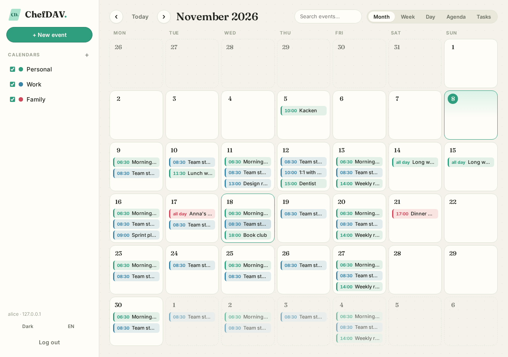
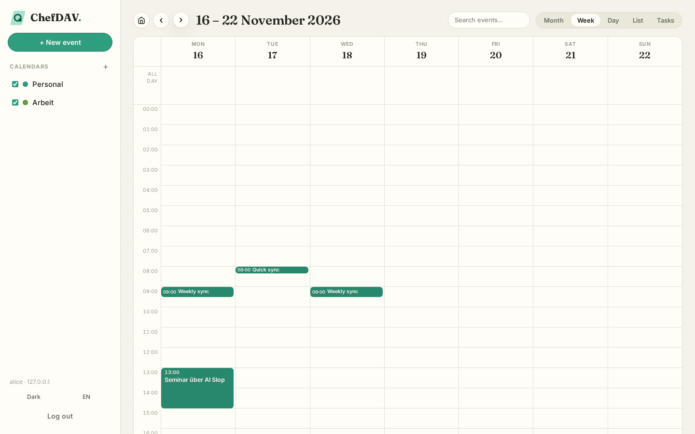
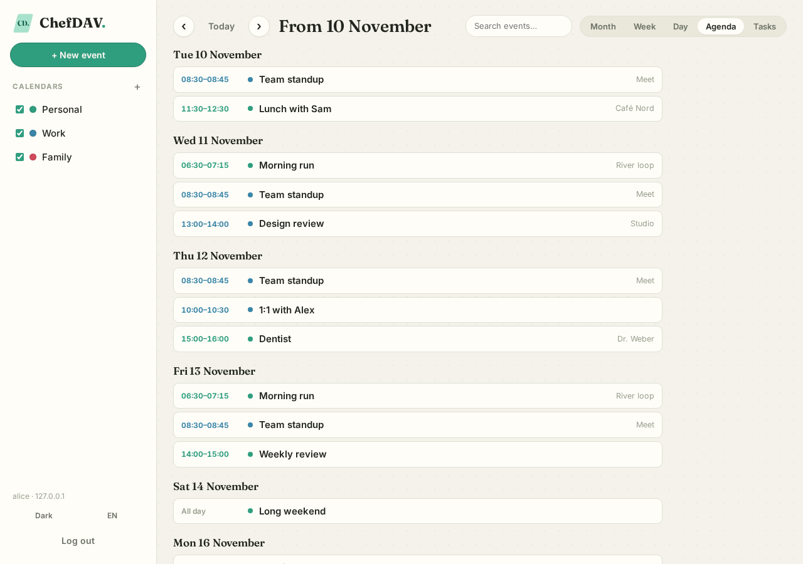
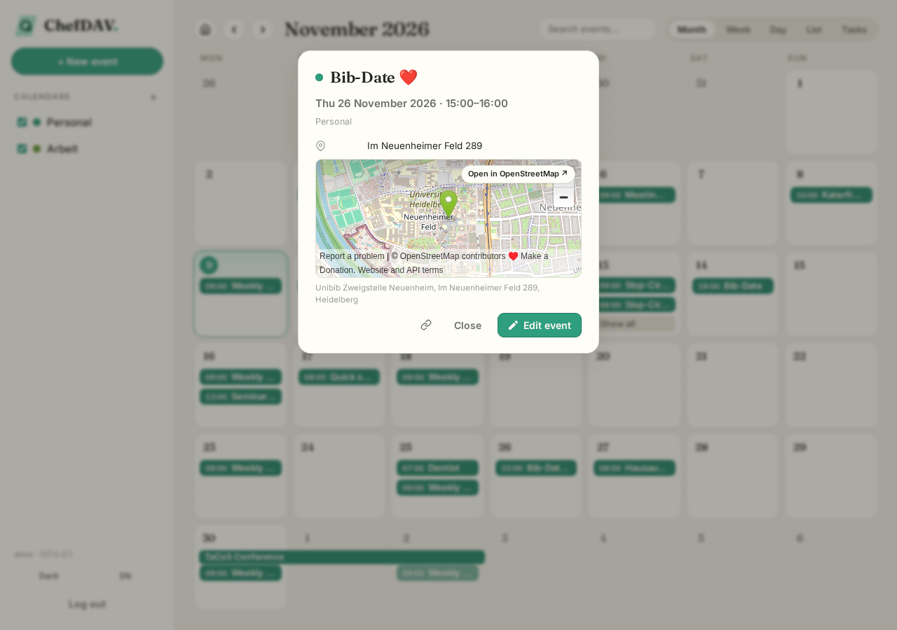

# ChefDAV

A **calendar web app that runs entirely in your browser** — written in **Rust,
compiled to WebAssembly**, talking directly to a **CalDAV server (Radicale)**.
There is no application backend: the only server-side pieces you operate are
Radicale itself plus a tiny reverse proxy that adds CORS headers.

Inspired by [AgenDAV](https://github.com/agendav/agendav) (PHP) — same idea,
modern look, Rust reliability.

> ⚠️ **Warning: this project is written entirely by AI.** The code, design and
> docs were generated by an AI assistant. Treat it like code from any other
> unreviewed source: read it before you trust it, test it against your own
> server, and do not run it with credentials you care about until you have
> reviewed what it does with them. No warranty — see [LICENSE](LICENSE).



## What you get

- **Five views** — Month grid, Week timeline, Day timeline, a 30-day Agenda list
  and a Tasks list — with a shared toolbar (prev / today / next, view switcher,
  search).
- **Full event CRUD** over CalDAV (create / edit / delete, optimistic
  concurrency via `If-Match`), with a read-only details card before the editor.
- **Recurrence** — RRULE/RDATE/EXDATE expanded client-side in the event's own
  timezone (DST-correct), an RRULE editor, and RECURRENCE-ID exceptions
  (*this event* / *this and following* / *all events*).
- **Multiple calendars** — create, rename, delete, show/hide, recolor (stored on
  the server via PROPPATCH), read-only detection, and a sharing panel with the
  calendar URL, your privileges and Radicale `[rights]` guidance.
- **Tasks (VTODO)** — create, edit, complete, delete.
- **Search, multi-select + bulk delete, drag & drop** between days.
- **Offline-friendly** — IndexedDB cache for instant paint, `sync-token`
  incremental sync, and an offline outbox that retries queued writes.
- **Stay logged in** — the saved session is restored on reload (with an opt-out
  checkbox; logging out forgets the password).
- **Location maps** — coordinates or addresses in an event's location show an
  OpenStreetMap preview with a pin; clicking it opens OSM in a new tab.
- **Look & feel** — warm paper + single mint accent (`#2f9e7f`), Fraunces +
  Inter, dark theme, full **English/German** UI (labels, dates, recurrence
  descriptions), keyboard shortcuts (`n t m w d a k / arrows Esc`), responsive
  down to phone widths.

| Week | Agenda | Event details with map |
| --- | --- | --- |
|  |  |  |

## How it works

```
┌───────────────────────────────┐     fetch: PROPFIND / REPORT / PUT / MKCALENDAR …
│  Browser: Rust → WASM SPA     │     (XML bodies, Basic auth header)
│  (Leptos, this repo)          │ ──▶ requires CORS headers
└───────────────────────────────┘     ▼
                              ┌──────────────┐
                              │ Caddy/nginx  │  adds Access-Control-*, answers OPTIONS
                              └──────────────┘
                                     ▼
                              ┌──────────────┐
                              │   Radicale   │  LDAP auth + file-based rights (ACLs)
                              └──────────────┘
```

- **Who may log in** is decided by Radicale (`[auth] type = ldap`); the SPA only
  sends Basic auth.
- **Who may read/write what** is decided by Radicale's `[rights]` file; the app
  reflects read-only calendars with a lock.
- All protocol, ICS and recurrence logic lives in a **pure-Rust crate**
  (`crates/caldav`) with native unit tests — the browser code is only glue + UI.

## Setup (production / day-to-day)

You need three things: a CalDAV server, a reverse proxy with CORS, and a static
host for the app.

1. **Radicale** — any self-hosted Radicale works (e.g. the Docker image
   `tomsquest/docker-radicale`), configured with your auth backend (htpasswd or
   LDAP) and `[rights]`.
2. **Caddy** in front of it, adding CORS headers (see `docker/caddy/Caddyfile`
   for a ready-made config):
   ```caddy
   your-caldav.example.com {
       reverse_proxy radicale:5232
       header Access-Control-Allow-Origin "https://your-app.example.com"
       header Access-Control-Allow-Methods "PROPFIND, REPORT, PUT, DELETE, MKCALENDAR, OPTIONS"
       header Access-Control-Allow-Headers "Authorization, Content-Type, Depth"
   }
   ```
3. **The app** — build and serve the static bundle:
   ```sh
   cargo install trunk          # once
   trunk build --release        # output in dist/
   # serve dist/ from any static host; optionally bake in your CalDAV URL:
   CHEFDAV_DAV_URL=https://your-caldav.example.com trunk build --release
   ```
   Then open the app, log in with server URL + your CalDAV credentials, and go.
   "Stay logged in" keeps you signed in across reloads on that device.

A single static file server is enough — no Node, no PHP, no app server. The
release bundle is ~2.7 MB wasm (~853 KB gzipped, mostly the timezone database).

## Development setup

Prerequisites: Rust toolchain with the `wasm32-unknown-unknown` target,
[trunk](https://trunkrs.dev), and a container runtime (Docker or rootless
Podman), plus Node.js + Playwright for the e2e tests.

```sh
# 1. local CalDAV stack: Radicale + Caddy (CORS) on 127.0.0.1:8080
systemctl --user start podman.socket        # rootless Podman socket (once per session)
podman compose -f docker/docker-compose.yml up -d
#    (with Docker: docker compose -f docker/docker-compose.yml up -d)
#    optional LDAP variant: add -f docker/docker-compose.ldap.yml
#    dev login: alice / secret

# 2. the app with hot reload
trunk serve        # → http://127.0.0.1:3100

# 3. tests (deterministic build, not trunk serve)
cargo test -p caldav && cargo test -p chef-dav --lib
cargo check --target wasm32-unknown-unknown
trunk build && python3 scripts/serve.py 3100 dist &
cd e2e && npm install && npx playwright install chromium
npm test && node features.mjs && node recurrence.mjs && node visibility.mjs \
  && node session.mjs && node location.mjs && node audit.mjs
```

There is also a **stable instance** for day-to-day use that is isolated from
development (own git tag, own ports 3200/8081, own Radicale volume):

```sh
./scripts/stable.sh     # → app on http://127.0.0.1:3200, CalDAV on :8081
```

## Project layout

```
ChefDAV/
├── Cargo.toml            # the WASM app (root package) + workspace
├── index.html  style/  public/  Trunk.toml
├── src/
│   ├── app.rs            # router + session restore
│   ├── api.rs            # fetch transport + sync operations
│   ├── state.rs          # Leptos signals (session, calendars, events, …)
│   ├── store.rs          # IndexedDB (credentials, cache, outbox, settings)
│   ├── location.rs       # coordinate parsing + OSM/Photon URLs
│   ├── views/            # login, shell, month, week, agenda, tasks
│   └── components/       # toolbar, modals, popovers, details + map
├── crates/caldav/        # pure-Rust, native-testable core
│   └── src/{client,xml,ics,recurrence,time,crypto,transport}.rs
├── e2e/                  # Playwright suites + screenshot/layout audit
├── docker/               # Radicale + Caddy (CORS) + optional glauth LDAP
└── scripts/              # serve.py (SPA static server), stable.sh
```

## Limitations

- **Credentials at rest are plain IndexedDB** while "Stay logged in" is enabled
  (origin-scoped — the practical limit of a client-only Basic-auth app). The
  AES-256-GCM/PBKDF2 flow exists in `crates/caldav/src/crypto.rs` and can be
  wired back in later. Turn off "Stay logged in" on shared devices.
- **Calendar sharing** is managed server-side in Radicale's `[rights]` file;
  the app shows the URL, your privileges and guidance but does not write ACLs.
- **Recurrence edits** are applied per occurrence/series as chosen in the scope
  dialog (RECURRENCE-ID / THISANDFUTURE).
- **No push notifications** — reminders were removed; use your OS calendar
  notifications if you need them.
- Location maps need internet access to OpenStreetMap/Photon; the calendar
  itself works fully offline from cache once loaded.

## Licensing / credits

See [LICENSE](LICENSE) and [NOTICE.md](NOTICE.md). ChefDAV itself (all code and
assets) is **MIT** — but note it was **generated entirely by AI**, so review
before relying on it. AgenDAV is AGPL-3.0 — we take inspiration from it
only, no code copied; if any of its code is ever ported verbatim, this project
must be relicensed AGPL-3.0 accordingly. Dependencies are permissive crates
(MIT/Apache-2.0/BSD/CC0/Zlib/Unicode-3.0 — see NOTICE.md); fonts (Fraunces,
Inter) are OFL and loaded at runtime from Google Fonts.
