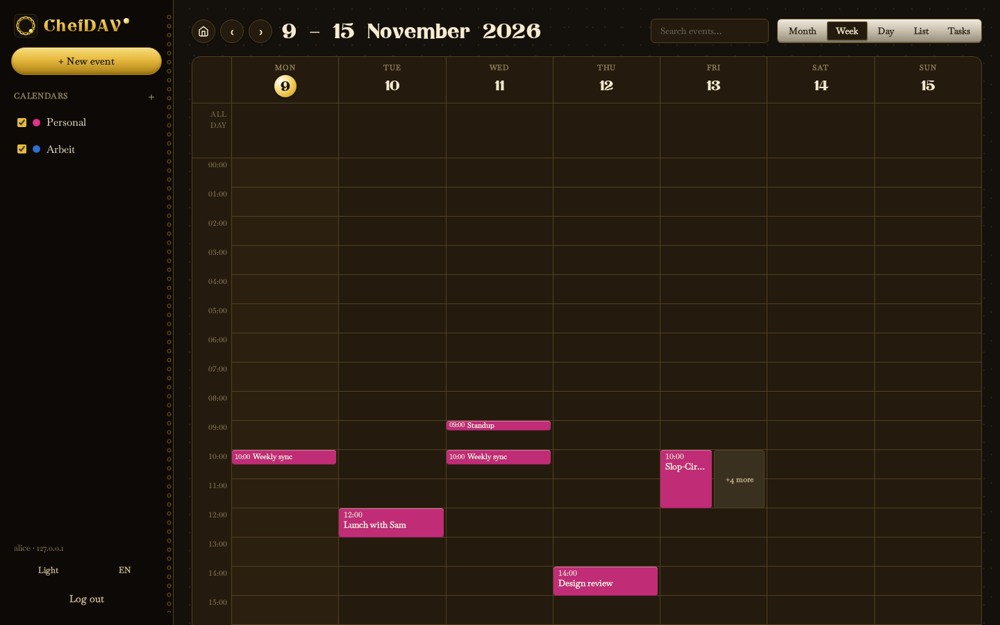
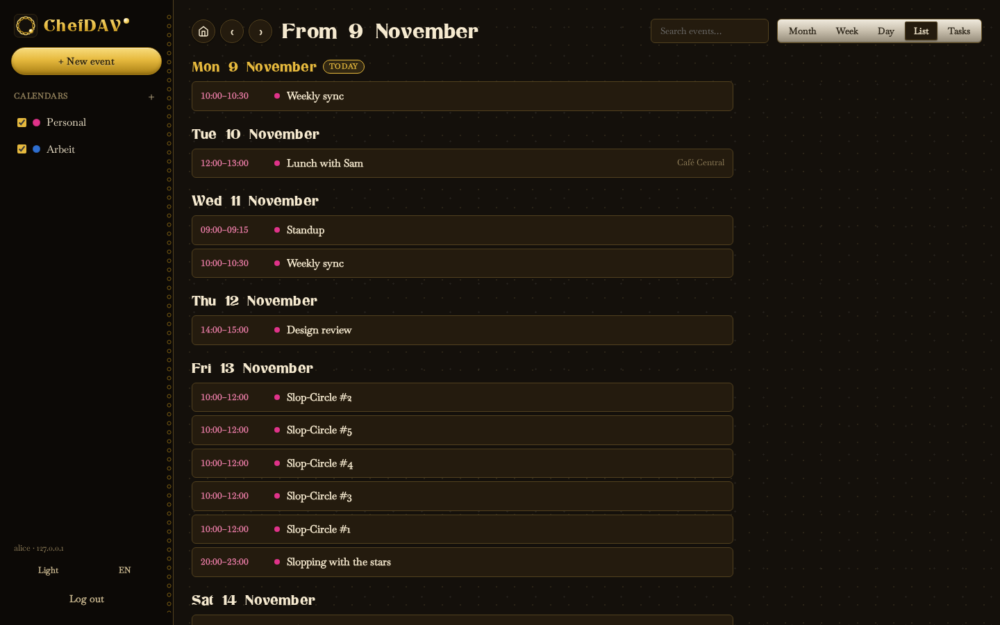

# ChefDAV

ChefDAV is a web frontend for a Radicale calendar server. It is written in Rust,
compiled to WebAssembly and runs in the browser. It has no backend of its own:
the browser talks CalDAV directly to Radicale, so Radicale plus a reverse proxy
for TLS (and CORS when the app lives on another origin) is all you need.

Every asset, fonts included, is bundled and served from the same origin. Nothing
is loaded from Google, Facebook or another CDN. The app talks to your calendar
server, and to OpenStreetMap when you open the optional location map.

It takes after [AgenDAV](https://github.com/agendav/agendav), with GNOME's
Adwaita as the visual language and the protocol logic in Rust.

> Warning: this project is written entirely by AI. The code, design and docs
> were generated by an AI assistant. Treat it like code from any other
> unreviewed source: read it before you trust it, test it against your own
> server, and do not run it with credentials you care about until you have
> checked what it does with them. No warranty. See [LICENSE](LICENSE).


## What you get

- **Month, week, day and list views**, plus a tasks view, all behind one
  toolbar with prev, today, next and a view switcher. On a computer, drag
  across empty timeline space to create an event with that start and end time;
  dragging into another day selects the rest of the first day, the days in
  between and up to the drop point, and the all-day row supports the same drag.
  In the month grid, drag across day cells to create a multi-day all-day event.
  On touch screens a tap opens the time-slot popup instead, so scrolling stays
  natural.
- **Recurring events.** RRULE, RDATE and EXDATE are expanded in the event's own
  timezone, with DST handled. There is an RRULE editor and per-instance
  exceptions (*this event*, *this and following*, *all events*).
- **Time zones.** Events render in your browser's zone, and the editor can
  store a timed event in any IANA zone. Existing events keep the zone they were
  saved in.
- **Multiple calendars.** Show or hide each one, give it a colour, and create or
  rename calendars from the sidebar.
- **Search** across all visible calendars from the toolbar.
- **Location preview.** Coordinates or addresses appear as a pin on an
  OpenStreetMap frame, and a click opens OSM in a new tab.
- **GTK-like design.** GTK4/libadwaita colours and radii, accent blue
  `#3584e4`, flat raised buttons, a segmented view switcher, GTK checkbuttons
  and a pill search entry. Light is the default; dark follows Adwaita. Klarissa
  sets the wordmark and headings, Montserrat the body text, both self-hosted.
  On phones the sidebar collapses behind a menu button and the day view fits
  the screen without horizontal scrolling.

| Week | List | Event details with map |
| --- | --- | --- |
|  |  |  |

## How it works

The browser loads the WASM bundle once. From then on it sends CalDAV requests
(`PROPFIND`, `REPORT`, `PUT`, `MKCALENDAR`, …) directly to your server with HTTP
Basic auth.

- **Logins are forwarded to Radicale.** The app passes the username and password
  along, and Radicale decides whether they are valid.
- **Radicale's `[rights]` file decides who may read or write what.** The app
  shows read-only calendars with a lock.
- **Protocol, ICS and recurrence logic live in `crates/caldav`**, a pure-Rust
  crate with native unit tests. The browser code is UI and glue.

## Deploy with Docker Compose

The published image `ghcr.io/chefexperte/chefdav` contains the calendar
frontend only: the static WASM app on a small Caddy file server. It has no
CalDAV server. The browser connects to your Radicale, so the proxy in front of
Radicale has to answer CORS preflights.

The stack below runs everything: Traefik routes by host and path and adds the
CORS headers, Radicale serves CalDAV at the site root, and ChefDAV is published
under `/ui` on the same host.

```yaml
name: chefdav

services:
  traefik:
    image: traefik:v3
    command:
      - --providers.docker=true
      - --providers.docker.exposedbydefault=false
      - --entrypoints.web.address=:80
    ports:
      - "8080:80"
    volumes:
      - /var/run/docker.sock:/var/run/docker.sock:ro

  radicale:
    image: tomsquest/docker-radicale:3.9.0.0
    volumes:
      - ./radicale/config:/config/config:ro
      - ./radicale/users:/config/users:ro
      - radicale-data:/data
    labels:
      - traefik.enable=true
      - traefik.http.routers.radicale.rule=Host(`calendar.example.com`)
      - traefik.http.routers.radicale.entrypoints=web
      - traefik.http.services.radicale.loadbalancer.server.port=5232
      # CORS for the app's origin (see the note below).
      - traefik.http.routers.radicale.middlewares=caldav-cors
      - traefik.http.middlewares.caldav-cors.headers.accesscontrolalloworiginlist=https://calendar.example.com
      - traefik.http.middlewares.caldav-cors.headers.accesscontrolallowmethods=GET,POST,PUT,DELETE,PROPFIND,PROPPATCH,REPORT,MKCOL,MKCALENDAR,OPTIONS
      - traefik.http.middlewares.caldav-cors.headers.accesscontrolallowheaders=Authorization,Content-Type,Depth,If-Match,If-None-Match,Overwrite
      - traefik.http.middlewares.caldav-cors.headers.accesscontrolexposeheaders=ETag,DAV,Content-Length
      - traefik.http.middlewares.caldav-cors.headers.accesscontrolmaxage=600

  chefdav:
    image: ghcr.io/chefexperte/chefdav:latest
    environment:
      BACKEND_URL: https://calendar.example.com
      BASE_PATH: /ui
    read_only: true
    tmpfs:
      - /srv-runtime
      - /tmp
    labels:
      - traefik.enable=true
      - traefik.http.routers.ui.rule=Host(`calendar.example.com`) && PathPrefix(`/ui`)
      - traefik.http.routers.ui.entrypoints=web
      - traefik.http.services.ui.loadbalancer.server.port=80
      # Optional, only for proxies that strip path prefixes (see below):
      # - traefik.http.routers.ui.middlewares=ui-strip
      # - traefik.http.middlewares.ui-strip.stripprefix.prefixes=/ui

volumes:
  radicale-data:
```

#### Radicale files

The compose file mounts two files under `./radicale/`. Create them before the
first start. If the source path is missing, Docker creates a directory instead,
and Radicale fails with `not a directory: Are you trying to mount a directory
onto a file`. If that already happened, delete the `radicale/config` directory
and create the file.

From a checkout:

```sh
mkdir -p radicale
cp docker/radicale/config radicale/config
cp docker/radicale/users radicale/users
```

Without a checkout, `radicale/config` needs at least this:

```ini
[server]
hosts = 0.0.0.0:5232

[auth]
type = htpasswd
htpasswd_filename = /config/users
htpasswd_encryption = bcrypt

[storage]
filesystem_folder = /data/collections

[rights]
type = owner_only

[web]
type = none
```

`radicale/users` is an htpasswd file with one line per account. This line is
`alice` / `secret`; replace it:

```text
alice:$2b$12$C.CsCg8m8yoNV/SIK6/J7eKLsIVmDuu/d2wQzHrHD4KsekSp0/HF6
```

Generate a new hash with:

```sh
docker run --rm httpd:alpine htpasswd -nbB <user> <password>
```

Run `docker compose up -d`, then open `https://calendar.example.com/ui/` once
that name points at the machine. For a local test, map the name to `127.0.0.1`
and use port 8080. Log in with your CalDAV credentials.

- **Radicale config:** `./radicale/config` and `./radicale/users` hold its
  configuration and htpasswd file. [`docker/radicale/`](docker/radicale/) has
  working examples with the dev login `alice` / `secret`.
- **CORS:** when the app and the CalDAV server share an origin, as they do
  above, the browser does not need CORS. The middleware matters when the app is
  served from another origin, and does no harm otherwise.
- **TLS:** the example uses Traefik's plain `web` entrypoint on port 8080. Add a
  `websecure` entrypoint and a certificate resolver for HTTPS.
- **App at the root:** drop `BASE_PATH` and the `PathPrefix` rule, and give
  Radicale its own host.

**Running it locally.** Traefik matches the host name and ignores the port, so
for a test without DNS use `localhost` everywhere. Everything else in the file
stays the same:

- `Host(\`localhost\`)` in both router rules, instead of `calendar.example.com`,
- `BACKEND_URL: http://localhost:8080`,
- the CORS origin `http://localhost:8080`,
- open <http://localhost:8080/ui/>.

No `/etc/hosts` entry is needed. If you browse to `127.0.0.1` instead, use
`Host(\`127.0.0.1\`)` and put the same host in `BACKEND_URL` and the CORS
origin.

**How `/ui` reaches the app.** `BASE_PATH=/ui` tells ChefDAV that it lives
under that path, so its links and deep links stay inside `/ui`. The Traefik
rule above only has to match the path and forward it unchanged; no prefix
stripping is involved.

The `ui-strip` middleware is an alternative for proxies that strip prefixes by
convention. Uncomment it and Traefik sends `/month/2026-11` to a container that
still knows the app is mounted at `/ui`. ChefDAV accepts both the prefixed and
the stripped form, so either routing style works. Pick the one your proxy setup
already uses and keep it consistent.

### What the image does

- Serves the app with an SPA fallback, so deep links and reloads
  (`/ui/month/2026-11`, `/week/2026-11-16`, `/event/<calendar>/<uid>`) work.
  Hashed bundle files are cached forever; `index.html` and the runtime config
  are not.
- Holds no state. Calendars live in Radicale and in the browser cache, so the
  container runs fine with a read-only root filesystem.
- Listens on plain HTTP port 80. Put it behind the TLS proxy that also serves
  your domain.
- Answers `/healthz` for container healthchecks and load balancers.

### Choosing the server at start-up

One image serves every deployment. The backend is a runtime environment
variable, not a build-time setting:

| Variable | Effect |
| --- | --- |
| `BACKEND_URL=https://dav.example.org` | the app uses that CalDAV server, and the login screen asks only for credentials |
| *(unset or empty)* | the login screen also asks for the server URL |
| `BASE_PATH=/ui` | the app is published under that path (assets, router, deep links) |

Change a value, restart the container (`docker compose up -d` recreates it), and
the app picks it up. No rebuild needed.

### Image tags

`latest` follows the default branch, `edge` is every push to it, and releases
also publish `X.Y.Z`/`X.Y` and `sha-<commit>`. The builds are smoke-tested by
[`.github/workflows/docker.yml`](.github/workflows/docker.yml). The image is
`linux/amd64`; [`docs/RELEASING.md`](docs/RELEASING.md) covers the release steps
and how to add arm64.

### Alternative: Caddy instead of Traefik

Caddy can handle the routing and CORS itself. Replace the `traefik` service with
this one and mount the Caddyfile below; `radicale` and `chefdav` stay as they
are:

```yaml
  caddy:
    image: caddy:2-alpine
    ports:
      - "80:80"
      - "443:443"
    volumes:
      - ./Caddyfile:/etc/caddy/Caddyfile:ro
      - caddy-data:/data
```

Add `caddy-data:` next to `radicale-data:` under `volumes:`. Caddy listens on
the standard ports, so the app is at `https://calendar.example.com/ui/`.

```caddy
calendar.example.com {
	# Answer preflights and expose the headers the app reads.
	@preflight method OPTIONS
	handle @preflight {
		header {
			Access-Control-Allow-Origin "https://calendar.example.com"
			Access-Control-Allow-Methods "GET, POST, PUT, DELETE, PROPFIND, PROPPATCH, REPORT, MKCOL, MKCALENDAR, OPTIONS"
			Access-Control-Allow-Headers "Authorization, Content-Type, Depth, If-Match, If-None-Match, Overwrite"
			Access-Control-Expose-Headers "ETag, DAV, Content-Length"
			Access-Control-Max-Age "600"
			Vary "Origin"
		}
		respond 204
	}

	# ChefDAV under /ui (the prefix is stripped before the container sees it).
	redir /ui /ui/ 308
	handle_path /ui/* {
		reverse_proxy chefdav:80
	}

	# Radicale at the site root.
	handle {
		header {
			Access-Control-Allow-Origin "https://calendar.example.com"
			Access-Control-Expose-Headers "ETag, DAV, Content-Length"
			Vary "Origin"
		}
		reverse_proxy radicale:5232
	}
}
```

Caddy's `handle_path` strips `/ui` before the request reaches the container.
That works because ChefDAV accepts the stripped form, and `BASE_PATH=/ui` keeps
the app's own URLs under `/ui`. If you prefer to forward the prefix unchanged,
use `handle /ui/*` with `reverse_proxy chefdav:80` instead.

Caddy gets TLS certificates on its own. If you built the bundle yourself instead
of using the image, Caddy can serve `dist/` from the site root with
`root * /srv/dist`, `try_files {path} /index.html` and `file_server`. Keep it at
the root; the container is what makes a path prefix (`BASE_PATH`) work.

## Development setup

You need a Rust toolchain with the `wasm32-unknown-unknown` target, [trunk](https://trunkrs.dev),
a container runtime (Docker or rootless Podman), and Node.js with Playwright for
the e2e tests.

```sh
# 1. local CalDAV stack: Radicale + Caddy (CORS) on 127.0.0.1:8080
systemctl --user start podman.socket        # rootless Podman socket (once per session)
podman compose -f docker/docker-compose.yml up -d
#    (with Docker: docker compose -f docker/docker-compose.yml up -d)
#    optional LDAP variant: add -f docker/docker-compose.ldap.yml
#    dev login: alice / secret
#    fresh volume (new machine)? seed the demo calendars + events:
./scripts/seed-dev.sh

# 2. the app with hot reload
trunk serve        # → http://127.0.0.1:3100

# 3. tests (deterministic build, not trunk serve)
cargo test -p caldav && cargo test -p chef-dav --lib
cargo check --target wasm32-unknown-unknown
trunk build && python3 scripts/serve.py 3100 dist &
cd e2e && npm install && npx playwright install chromium
npm test && node features.mjs && node recurrence.mjs && node visibility.mjs \
  && node fixed-backend.mjs && node session.mjs && node location.mjs \
  && node audit.mjs
```

## Project layout

```
ChefDAV/
├── Cargo.toml            # the WASM app (root package) + workspace
├── index.html  style/  public/  Trunk.toml
├── src/
│   ├── app.rs            # router + session restore
│   ├── api.rs            # fetch transport + sync operations
│   ├── state.rs          # Leptos signals (session, calendars, events, …)
│   ├── store.rs          # IndexedDB (credentials, cache, outbox, settings)
│   ├── location.rs       # coordinate parsing + OSM/Photon URLs
│   ├── views/            # login, shell, month, week, agenda, tasks
│   └── components/       # toolbar, modals, popovers, details + map
├── crates/caldav/        # pure-Rust, native-testable core
│   └── src/{client,xml,ics,recurrence,time,crypto,transport}.rs
├── e2e/                  # Playwright suites + screenshot/layout audit
├── docker/               # Dockerfile + compose files (published image),
│                         # Radicale/Caddy for dev, optional glauth LDAP
└── scripts/              # serve.py (SPA static server), seed/clean helpers
```

## Limitations

- Sharing is set in Radicale's `[rights]` file. The app shows the calendar URL,
  your privileges and guidance, but does not write ACLs.
- The map preview needs OpenStreetMap/Photon. Once the calendar has loaded, it
  works from cache without a connection.

## Licensing / credits

ChefDAV (all code and assets in this repository) is MIT. See
[LICENSE](LICENSE). Third-party components and bundled files are listed in
[NOTICE.md](NOTICE.md).

- [AgenDAV](https://github.com/agendav/agendav) (AGPL-3.0) inspired the project.
  No AgenDAV code is used.
- Montserrat (SIL OFL) and Klarissa (1001Fonts FFC, EULA in `public/fonts/`) are
  bundled and served from the same origin.
- The Rust dependencies are permissive crates (MIT, Apache-2.0, BSD, CC0, Zlib,
  Unicode-3.0); the full list is in `NOTICE.md`.

Nothing is loaded from a third-party CDN.
